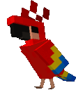

<h1 align="center"><b>Hi, I'm Franco Oyhenart </b></h1>

&nbsp;***About me***

I'm an advanced Information Systems Engineering student from La Plata, Argentina, and I work as a software developer. I build across the whole stack, from React and Next.js on the front end to Express and Django on the back end, and I enjoy turning messy requirements into clean systems that luckily work.

- 💼 Most of my day-to-day code lives in private GitLab repos at work. Side projects are coming here soon.
- 🌱 Currently learning Django
- 🛠️ Improving my software architecture and system design skills
- 🌎 Open to remote opportunities with US-based companies (UTC-3, great overlap with US hours)
- 💬 Ask me about anything, I'm happy to help
- 🧉 Powered by mate
- 📫 Reach out to me at: <a href="mailto:franoyhenart07@gmail.com">franoyhenart07@gmail.com</a>

 

## My Skills Include

<h4> Languages & Frameworks </h4>

  
  
  
  
  
  
  
  
  
  
  
  

<h4> Databases, Tools & Technologies </h4>

  
  
  
  
  
  
  
  
  
  
  

## Let's Connect

